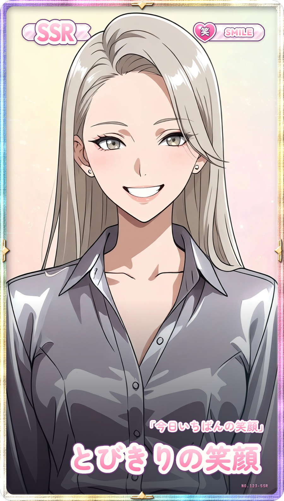

# SSRGenerate-Lite

写真を1枚渡すだけで、ソシャゲの「SSR当選」の瞬間を再現した16秒の演出動画と、フル解像度のカード静止画が返ってきます。
このリポジトリは、その生成を **AIエージェントが自分で実行する** ための軽量版です。



*生成例（cute-pastel）。動画（縦 540×960）と、このカード静止画（縦 900×1590）が同時に出力されます。*

生成例の動画（16秒）:

https://github.com/user-attachments/assets/69884864-1e3e-4cc2-a816-392e275edd5b

## できること

- **動画 MP4** — 16.0秒、縦 `540×960` / 横 `960×540`、24fps。召喚演出からリザルト画面までを、乱数・時刻・ネットワークに依存しない決定論的な手順でレンダリングします。
- **カード静止画 `.card.png`** — 縦 `900×1590` / 横 `1480×860` のフル解像度。動画と同時に出力されます。
- **自動 QA** — 解像度・尺・音量などを定量チェックし、合格したものだけを納品物とします。
- **写真は無加工** — 入力写真は100%クリアなまま維持され、演出はその周りで組み立てられます。

## エージェント向けの設計

手順書（`skill/SKILL.md`）と実行 CLI（`agent/ssr_agent.py`）が同梱されていて、エージェントは4つの入口から使えます。

| モード | 入口 |
|:---|:---|
| **A. 記入シート** | JSON で項目を指定する |
| **B. 自然文** | 「この写真で、かわいい感じで、タイトルは○○」のような文章から項目を読み取る |
| **C. おまかせ** | 写真だけ。プリセット二択（かっこいい系／かわいい系）から先はエージェントが決める |
| **D. 画像生成後の提案** | エージェントが画像を生成した直後に、動画とカードも作れることをユーザーへ提案する |

どの入口でも、最終的には再現可能な `request.json` にそろえてから生成します。

## クイックスタート

```bash
# 1. 初回セットアップ（venv 作成・依存インストール・フォント取得・アセット生成・事前 check）
#    Linux / macOS / Muse VM:
bash agent/setup_env.sh
#    Windows PowerShell:
#    pwsh -ExecutionPolicy Bypass -File agent/setup_env.ps1

# 2. 環境・対応機能の確認
.venv/bin/python agent/ssr_agent.py capabilities --json

# 3. 記入シートからレンダリング＋自動 QA
.venv/bin/python agent/ssr_agent.py render --request agent/examples/sheet_cute_portrait.json --json

# 4. おまかせモード（写真＋ cool / cute の二択から自動生成）
.venv/bin/python agent/ssr_agent.py omakase --photo assets/photo.jpg --style cute --json

# 5. 既存 MP4 の定量 QA
.venv/bin/python agent/ssr_agent.py qa --file renders/SSR_cute-pastel_20261123.mp4 --json
```

クローン直後のリポジトリは約1 MB です。フォントと生成アセットは初回セットアップで取得・生成するため、ネットワーク接続が必要です（セットアップ後の実働サイズは約350〜590 MB）。

## 出力仕様

| 項目 | 値 |
|:---|:---|
| 動画 | 16.0秒 / 縦 `540×960`・横 `960×540` / 24fps / CRF 20 |
| カード静止画 | 縦 `900×1590`・横 `1480×860` PNG |
| 音声 | 効果音を自動生成し、`-14 LUFS` 基準で QA |
| 所要時間の目安 | GPU なし VM（4 vCPU）で約2分 / RTX 4070 で約45秒 |

## 本家との関係

フル品質版（1080p / 30fps）の本家 **SSRGenerate** から、エージェント実行用に軽量化した派生リポジトリです。内部レイアウトは本家と同一の座標系のまま、動画出力だけを 540p に落とし、カード静止画はフル解像度を維持しています。起点コミットとデチューンの内容は [`UPSTREAM.md`](./UPSTREAM.md) に記録しています。

## npm コマンド（本家互換）

```bash
npm run build:assets   # 全ての生成アセット（タイポ・光学・フレーム・効果音）を一括並列生成
npm run check          # HyperFrames lint + runtime + layout + motion 検証
npm run render         # 540p / 24fps / CRF 20 で MP4 + フル解像度 .card.png 同時書き出し
npm run render:card    # フル解像度 card.png（900x1590 / 1480x860）単体書き出し
npm run qa -- renders/SSR_cute-pastel_20261123.mp4 --check-audio  # 定量 QA
```

## ライセンス

MIT License（全文は [LICENSE](LICENSE) を参照）。なお、セットアップ時に取得するフォントには、それぞれのフォントのライセンスが適用されます。

## 開発について

SSRGenerate-Lite は、人間（企画・ローカル実装）、Google Antigravity、そして Muse 上のパーソナルエージェントの三人で共同開発しています。
エージェントが自分の環境で clone して実際に動かし、詰まったところを直して返す。その往復の中で育ってきたリポジトリです。
